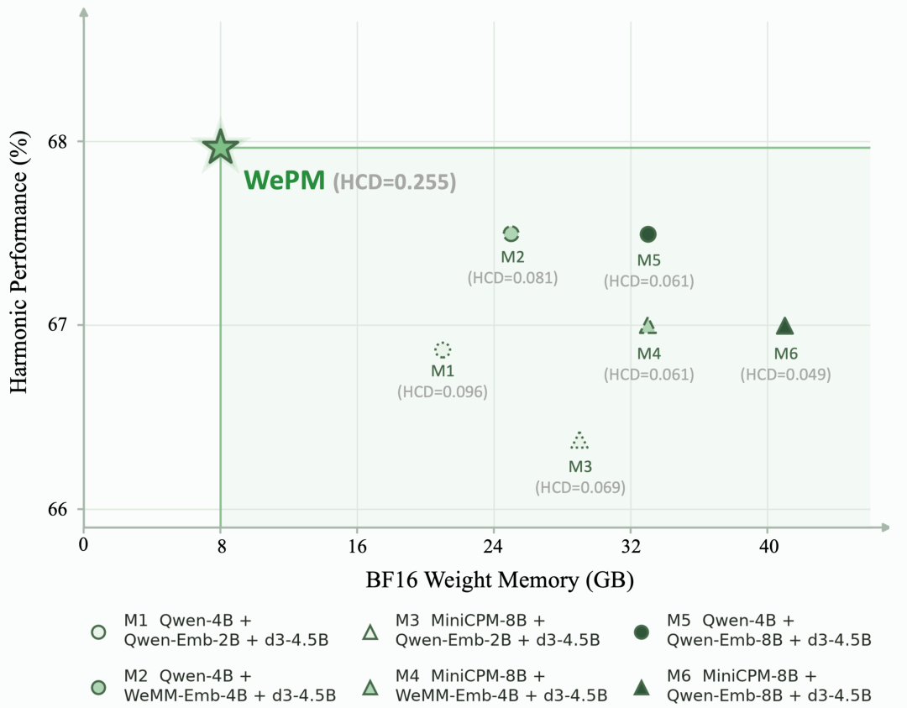

# WePM: Hierarchical Conflict Reconciliation for Unified MLLMs

<p align="center">
  <i>Unified Pocket Models for In-App Multimodal Intelligence</i>
</p>

<p align="center">
  <b>Model weights</b>: TBD &nbsp;|&nbsp; <b>Technical Report</b>: TBD &nbsp;|&nbsp; <b>Code & Evaluation</b>: TBD
</p>

## Model Introduction

WePM is a unified multimodal model built for on-device AI. Instead of keeping one model per capability — an embedding model for album search, a generator for OCR and visual question answering, and a classifier for tool routing — WePM keeps a single 4B vision–language backbone in BF16 (≈8 GB of weights) and serves all of them from the same parameters.

- **Representation** — L2-normalized multimodal embeddings for image retrieval, text retrieval and candidate ranking.
- **Generation** — OCR, image captioning, visual question answering, summarization and assistant replies.
- **Decision** — typed decision paths for option selection, ordinal scoring and binary judgment.


Unifying these paths is not a matter of mixing datasets. When representation, generation and decision share one compact backbone, three conflicts appear: the visual granularity each task needs differs, the supervision each dataset provides is different, and the loss scales of the three tasks are not comparable. WePM addresses them with three designs:

- **MGVB (Multi-Granularity Visual Bottleneck)** splits a fixed visual token budget into global, regional and fine-grained banks, so a task can allocate its limited context to the visual evidence it actually needs.
- **ULKD (Unified Listwise Knowledge Distillation)** distills from two teachers — a generation teacher and a representation teacher — along the student's own generation trajectory, so unpaired retrieval and generation data can supervise one student.
- **SEMO (Stable and Efficient Multitask Optimization)** fixes task loss coefficients, schedules how often each task appears per round, and accumulates gradients across sequential forward/backward passes before a single update. This removes the need to keep all task computation graphs alive at once.


## Performance

Evaluation covers 16 benchmarks in five groups: image retrieval, text retrieval, math and science reasoning, visual question answering, and OCR / document understanding. All baselines were reproduced with identical input resolution and evaluation scripts. `Joint` is not a flat average over benchmarks: it first aggregates the Embedding and Generation groups separately, then averages the two group scores with equal weight.

| Method | ImageRet. | TextRet. | Math | VQA | OCR | Joint |
| --- | ---: | ---: | ---: | ---: | ---: | ---: |
| CAFe | 22.83 | 30.30 | 7.18 | 13.71 | 40.97 | 23.59 |
| FROMAGe | 32.30 | 33.12 | 22.60 | 34.29 | 61.86 | 36.15 |
| MMGen | 30.93 | 33.26 | 24.17 | 39.05 | 60.11 | 36.60 |
| ULME | 34.13 | 32.78 | 28.16 | 41.46 | 58.93 | 38.15 |
| **WePM** | **41.30** | **35.90** | **58.60** | **60.84** | **81.18** | **52.74** |

Against ULME, the strongest prior unified retrieval–generation baseline, WePM improves ImageRet. by +7.17, TextRet. by +2.64, Math by +30.44, VQA by +19.38 and OCR by +19.32, lifting `Joint` from 38.15 to 52.74 (+14.59). The gains are not concentrated in one group: the Embedding aggregate reaches 38.60 (ULME: 33.46) and the Generation aggregate reaches 66.87 (ULME: 42.85).

Decision capability (choice, ordinal scoring, binary judgment) is part of the model interface but is not included in the table above; its full evaluation will be released with the complete results.

## Heterogeneous Capability Density (HCD)

Parameter count and per-benchmark scores do not answer the question that matters on a device: **for a fixed resident memory budget, how much usable intelligence does a model provide?**

HCD is defined as:

$$
\mathrm{HCD} = \frac{\bigl(\text{number of capability families above the usability threshold}\bigr) \times \bigl(\text{aggregate capability quality}\bigr)}{\text{resident inference memory}}
$$

Counting is done per capability family, not per benchmark: OCR, captioning and VQA all belong to Generation and are not counted three times.



The figure above is an early slice of this comparison. It covers Generation and Representation only, and counts BF16 weights only — KV cache, activations, framework overhead and runtime fragmentation are excluded. In this setting, deploying Qwen3.5-4B and WeMM-Emb-4B separately requires ≈16 GB of BF16 weights and reaches an aggregate quality of 63.08; WePM reaches 63.12 with ≈8 GB. The independent composition closest in quality to WePM actually requires 24 GB, not 16 GB.

<!-- TBD: replace with the full three-family HCD figure (WePM vs. generator + embedder + decision model), including usability thresholds and resident inference memory at runtime. -->

## Applications

Both demos run fully on device: no image, text or interaction data leaves the local machine.

### 1. Personal Agent

One WePM-4B handles the whole loop — retrieving local content, generating a reply grounded in personal information, and making the typed decision that routes the next step. Retrieval, generation and decision alternate inside a single resident model.

[▶ Watch the Personal Agent demo (`.mov`)](assert/personal_agent_%E7%B4%A0%E6%9D%90.mov)

<!-- TBD: capture device, memory footprint, precision and latency numbers for this demo. -->

### 2. On-Device Game Assistant

The same WePM-4B reads game frames and on-screen text, retrieves local knowledge and history, generates real-time suggestions, and performs option judgment or action routing for the current state — avoiding a separate vision model, retrieval model and decision model.

<!-- TBD: demo video. -->

## Inference on NVIDIA GPU

An approximate memory budget for BF16 inference:

| Precision | Weights | Recommended GPU memory |
| --- | ---: | --- |
| BF16 | ≈8 GB | ≥16 GB (e.g. RTX 4090 / A100) |
| FP16 | ≈8 GB | ≥16 GB |

Install dependencies:

```bash
pip install -r requirements.txt
```

Run the bundled script:

```bash
python inference.py \
  --model ./checkpoints/WePM-4B \
  --image ./assert/wepm_function.png \
  --prompt "Describe this figure in one sentence." \
  --max-new-tokens 256
```

`inference.py` loads the model with `device_map="auto"` and `torch.bfloat16`, applies the chat template, and prints the decoded answer. The core of it is:

```python
from transformers import AutoModelForImageTextToText, AutoProcessor

model_path = "./checkpoints/WePM-4B"

processor = AutoProcessor.from_pretrained(model_path, trust_remote_code=True)
model = AutoModelForImageTextToText.from_pretrained(
    model_path,
    dtype=torch.bfloat16,
    device_map="auto",
    trust_remote_code=True,
).eval()

messages = [{
    "role": "user",
    "content": [
        {"type": "image", "path": "./assert/wepm_function.png"},
        {"type": "text", "text": "Describe this figure in one sentence."},
    ],
}]
inputs = processor.apply_chat_template(
    messages,
    add_generation_prompt=True,
    tokenize=True,
    return_dict=True,
    return_tensors="pt",
).to(model.device)

output_ids = model.generate(**inputs, max_new_tokens=256)
answer = processor.tokenizer.decode(
    output_ids[0, inputs["input_ids"].shape[-1]:], skip_special_tokens=True
)
print(answer)
```

<!-- TBD: add the embedding and typed-decision entry points (query/document encoding, choice / ordinal / binary heads) once the public interface is fixed. -->

## Model Links

| Model | Description | Link |
| --- | --- | --- |
| WePM-4B | Unified retrieval / generation / decision model, BF16 | TBD |
| WePM-4B (quantized) | Lower-bit on-device release | TBD |

## Citation

If you find this work useful, please consider citing it:

```bibtex
@misc{wepm2026,
  title = {WePM: Hierarchical Conflict Reconciliation for Unified MLLMs},
  author = {{WeChat AI, Tencent}},
  year = {2026},
  howpublished = {Technical Report},
  url = {TBD}
}
```

## License

TBD. Third-party components remain subject to their original licenses.
