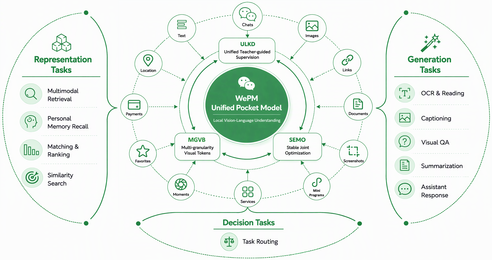
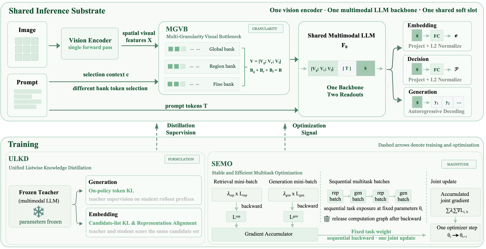
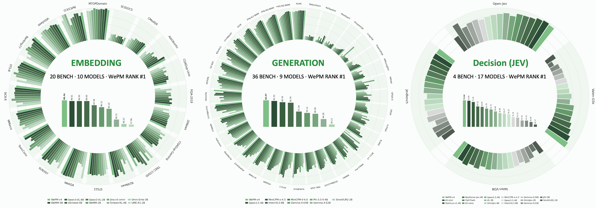

<h1 align="center">WePocketModel</h1>

<h3 align="center">Unified Pocket Models for In-App Multimodal Intelligence</h3>

<p align="center">
  
  <a href="https://huggingface.co/tencent/WePocketModel1.0-2B"></a>
  <a href="https://huggingface.co/tencent/WePocketModel1.0-4B"></a>
  <a href="LICENSE"></a>
</p>

## Model Introduction

On-device AI applications rarely depend on a single capability. A personal assistant may need multimodal retrieval to find local content, generation to understand and respond, and decision making to route the next action. Deploying a separate specialist for each path duplicates vision encoders and language backbones, increasing resident memory, system complexity and the cost of keeping intelligence always available on device.

**WePM (WePocketModel1.0)** is a unified multimodal model family with planned **2B and 4B** releases, designed around a different principle: one compact vision–language backbone should support multiple capability families without sacrificing their individual quality. A single set of parameters provides:

- **Representation** — L2-normalized multimodal embeddings for image retrieval, text retrieval and candidate ranking.
- **Generation** — OCR, image captioning, visual question answering, summarization and assistant responses.
- **Decision** — typed outputs for option selection, ordinal scoring and binary judgment.

In BF16, the shared 4B backbone occupies approximately 8 GB of weight memory. More importantly, it replaces several independently resident models with one common foundation for local multimodal applications.

<p align="center">
  
</p>

### Reconciling Conflicts in a Unified Model

Simply mixing heterogeneous tasks does not make them compatible. WePM identifies conflicts at three levels: different tasks require different visual granularity, their datasets provide different forms of supervision, and their losses operate at different scales and training rhythms. WePM reconciles these conflicts with three complementary components:

- **MGVB (Multi-Granularity Visual Budgeting)** allocates a fixed total visual-token budget across global, regional and fine-grained banks using prompt-conditioned selection. It preserves scene-level semantics, object relations and local details while allowing each task to focus on the evidence it needs.
- **ULKD (Unified Listwise Knowledge Distillation)** transfers generation and embedding knowledge from a frozen multimodal teacher into one student. On the generation path, on-policy token-level KL distillation supervises prefixes visited by the student itself; on the embedding path, candidate-list KL distillation and representation alignment teach the student candidate rankings and embedding structure.
- **SEMO (Stable and Efficient Multitask Optimization)** accumulates fixed-weight task gradients through sequential forward/backward passes at the same model parameters, releasing each computation graph after backward before one joint optimizer update. This stabilizes optimization while avoiding the memory cost of retaining every task graph concurrently.

Together, these designs align visual evidence, learning signals and optimization dynamics within one compact backbone. Inference uses one vision encoder, one shared multimodal LLM backbone and one shared soft slot, with projection-based embedding/decision readouts and autoregressive generation.

<p align="center">
  
</p>

## Performance Across Three Capability Families

WePM is evaluated across all three capability families rather than through a single aggregate score: **Embedding** covers 30 benchmarks and 9 models, **Generation** covers 39 benchmarks and 9 models, and **Decision (JEV)** covers 7 benchmarks and 21 models. The figure summarizes the benchmark-level comparisons and reports WePM's overall rank within each evaluation pool.

<p align="center">
  
</p>

WePM ranks first overall in each of the three evaluation pools. These results show that one shared 4B backbone can support competitive embedding, generation and decision capabilities together. The ranking is an overall result within each capability family, not a claim that WePM leads every individual benchmark.

## Heterogeneous Capability Density (HCD)

Benchmark quality alone does not capture the central constraint of on-device deployment: **how much usable intelligence can remain resident within a fixed memory budget?** We introduce **Heterogeneous Capability Density (HCD)** to jointly account for capability breadth, capability quality and resident inference memory.

<p align="center">
  
</p>

HCD counts capability families rather than individual benchmarks. For example, OCR, captioning and visual question answering all contribute to Generation instead of being counted as three separate capabilities. A higher HCD therefore indicates that a model delivers broader and stronger usable intelligence per unit of resident memory—not merely that it has been evaluated on more tasks.

<p align="center">
  
</p>

The comparison pairs independent generation and embedding models with the same d3-4.5B decision model. WePM reaches approximately 65.1% harmonic performance with about 8 GB of BF16 weight memory, yielding an HCD of 0.244. The six independent three-model compositions require roughly 21–43 GB, with harmonic performance of approximately 64.2–64.8% and HCD values of 0.045–0.092. In this comparison, WePM achieves higher harmonic performance with substantially less weight memory, delivering approximately 2.7–5.4× the HCD of the independent compositions.

The memory values and HCD comparison above use BF16 weights only, not full runtime memory. KV cache, activations, framework overhead and runtime fragmentation are excluded.

## Applications

WePM is intended as a shared local intelligence layer rather than a collection of benchmark-specific interfaces. The following demos run fully on device, keeping personal images, text and interaction data local.

### 1. Personal Agent

A single resident WePM-4B supports the complete local workflow: it retrieves relevant personal content, understands multimodal context, generates a grounded response and makes the typed decision that routes the next step. Retrieval, generation and decision are composed within one model instead of being dispatched to separate services.

<p align="center">
  <video src="assert/personal_agent_demo.mp4" poster="assert/personal_agent_poster.jpg" width="640" controls muted loop playsinline></video>
</p>

If the player above is not rendered by your Markdown viewer, open the [MP4 demo](assert/personal_agent_demo.mp4) directly.

<!-- TBD: capture device, memory footprint, precision and latency numbers for this demo. -->

### 2. On-Device Game Assistant

The same WePM-4B interprets game frames and interface text, retrieves local knowledge and interaction history, generates contextual suggestions, and performs option judgment or action routing. This turns one continuously resident model into a complete multimodal game assistant without separately loading vision, retrieval and decision models.

<p align="center">
  <video src="assert/game_assistant_demo.mp4" poster="assert/game_assistant_poster.jpg" width="640" controls muted loop playsinline></video>
</p>

If the player above is not rendered by your Markdown viewer, open the [MP4 demo](assert/game_assistant_demo.mp4) directly.

## Inference

Runtime code and runnable cases are maintained in GitLab; the 2B and 4B model releases will be hosted separately on Hugging Face:

| Model size | Hugging Face / safetensors |
| --- | --- |
| 4B | [WePocketModel1.0-4B](https://huggingface.co/tencent/WePocketModel1.0-4B) |
| 2B | [WePocketModel1.0-2B](https://huggingface.co/tencent/WePocketModel1.0-2B) |

These are the planned release addresses; downloads require the corresponding repositories to be published.

```text
inference/              # Hugging Face Transformers inference implementation
examples/gpu/           # NVIDIA GPU task cases and input assets
examples/cpu/           # CPU task cases and input assets
checkpoints/            # Optional local downloads; model files are not tracked
```

The runnable examples use the complete Hugging Face export and support generation, embedding extraction, and structured decision. Generation cases cover single-text, single-image, and ordered text–image interleaving. The current results and hardware measurements in this README are for the 4B model, not the 2B release. The shared loader requires the same task_slots_v1 export contract; 2B inference will be validated after its checkpoint is available.

### Hardware and precision (4B)

| Device | Compute | Approximate weight memory | Recommended memory |
| --- | --- | --- | --- |
| NVIDIA GPU | BF16 | ≈8 GB | ≥16 GB GPU memory |
| CPU | FP32 | ≈17 GiB | ≥24 GiB system memory |

### Clone the code

Clone the inference code and examples:

```bash
git clone https://git.woa.com/seraphyuan/WePM.git
cd WePM
```

The current branch does not bundle model weights or require Git LFS. Inference resolves the complete 2B or 4B export from Hugging Face or an explicitly selected local directory.

### Installation

Create a Python 3.10–3.13 environment:

```bash
python -m venv .venv
source .venv/bin/activate
```

NVIDIA GPU (CUDA 12.8 example):

```bash
python -m pip install torch==2.10.0 torchvision==0.25.0 \
  --index-url https://download.pytorch.org/whl/cu128
python -m pip install -r inference/requirements.txt
```

CPU:

```bash
python -m pip install torch==2.10.0 torchvision==0.25.0 \
  --index-url https://download.pytorch.org/whl/cpu
python -m pip install -r inference/requirements.txt
```

### Model selection and download

The scripts default to `tencent/WePocketModel1.0-4B`. The first online run downloads the complete export into the Hugging Face cache; subsequent runs reuse the cached files. Switch to the 2B release once published:

```bash
export WEPM_MODEL=tencent/WePocketModel1.0-2B
```

To download ahead of time and keep weights in a local directory:

```bash
hf download tencent/WePocketModel1.0-4B --local-dir checkpoints/WePocketModel1.0-4B
export WEPM_MODEL="$PWD/checkpoints/WePocketModel1.0-4B"
```

A local model directory is loaded without network access. For a cached repository ID, set `HF_HUB_OFFLINE=1` to prohibit network access. The [inference CLI](inference/README.md) also provides `--revision`, `--cache-dir`, and `--local-files-only`. Download the complete repository, not just the safetensors shards: auxiliary weights, runtime sources, tokenizer, processor and export metadata are required.

### NVIDIA GPU inference

#### Generation: single text, single image, or interleaved content

```bash
bash examples/gpu/generation/run.sh single_text
bash examples/gpu/generation/run.sh single_image
bash examples/gpu/generation/run.sh interleaved
```

#### Embedding extraction

```bash
bash examples/gpu/embedding/run.sh
```

#### Structured decision

```bash
bash examples/gpu/decision/run.sh
```

### CPU inference

#### Generation: single text, single image, or interleaved content

```bash
bash examples/cpu/generation/run.sh single_text
bash examples/cpu/generation/run.sh single_image
bash examples/cpu/generation/run.sh interleaved
```

#### Embedding extraction

```bash
bash examples/cpu/embedding/run.sh
```

#### Structured decision

```bash
bash examples/cpu/decision/run.sh
```

Each command writes a timestamped JSON result, releases the model, and exits. See the [inference guide](inference/README.md) for the CLI and ordered multimodal input format, and the [examples guide](examples/README.md) for all runnable cases.

## Citation

If you find this work useful, please consider citing it:

```bibtex
@misc{wepm2026,
  title = {WePM: Hierarchical Conflict Reconciliation for Unified MLLMs},
  author = {{WeChat AI, Tencent}},
  year = {2026},
  howpublished = {Technical Report},
  url = {TBD}
}
```

## License

The code made publicly available by Tencent in this repository is licensed under the Apache License, Version 2.0. See [LICENSE](LICENSE) for the complete terms and Tencent copyright notice.

This code license does not declare a license for model weights. Consult the license provided in each Hugging Face model repository for the applicable weight terms. Third-party components remain subject to their original licenses.
