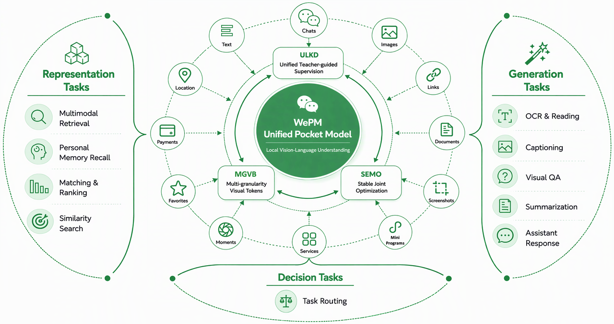
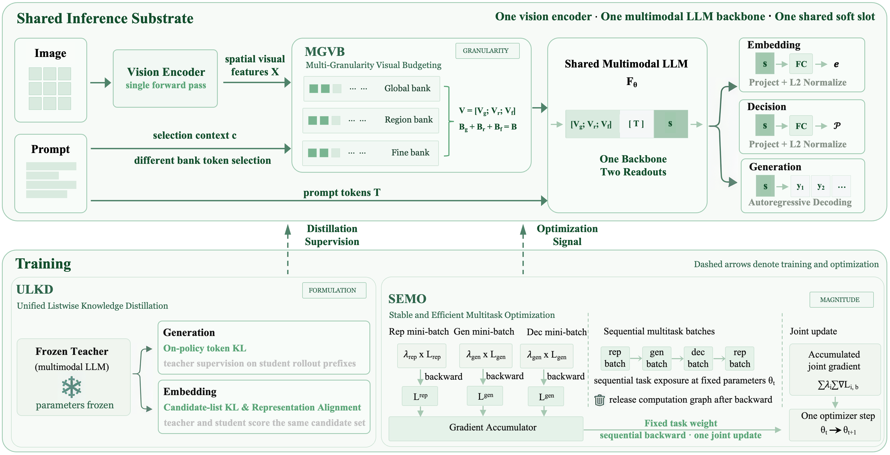
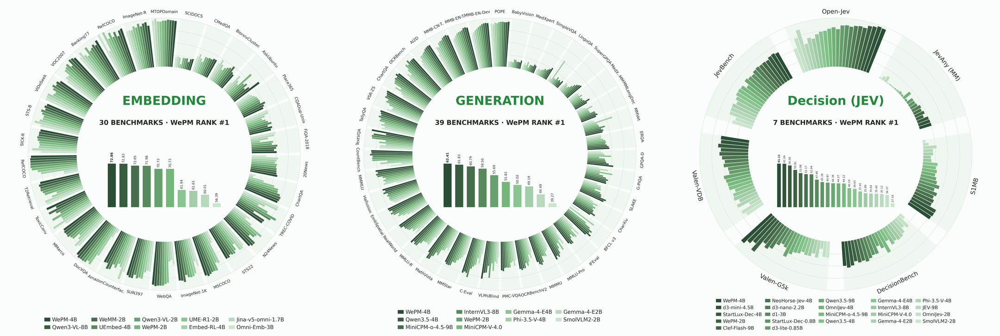
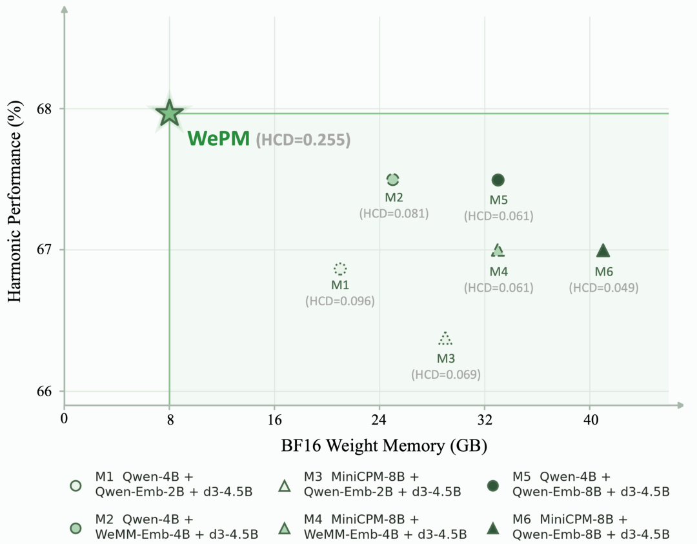

<h1 align="center">面向应用内多模态智能的统一轻量模型</h1>

<h3 align="center">WePocketModel (WePM)</h3>

<p align="center">
  
  <a href="https://huggingface.co/collections/tencent/wepocketmodel"></a>
  <a href="LICENSE"></a>
</p>

<p align="center">
  <strong><a href="https://github.com/Tencent/WePocketModel/blob/7702be7732464cff64971dda73f6f2590f44ba21/README.md">WePM 1.0</a></strong>
</p>

<p align="center">
  <sub><a href="#模型介绍">模型概览</a> &nbsp;·&nbsp; <a href="#快速开始">开始使用</a> &nbsp;·&nbsp; <a href="#项目资源">项目资源</a> &nbsp;|&nbsp; 中文 · <a href="README.md">English</a></sub>
</p>

## 动态

- **2026-11-19** · 补齐了 WePM 1.0 的 [2B 和 4B 模型链接](#模型权重)，涵盖 Transformers 和 GGUF 两种格式，并提供了 NVIDIA GPU 和 CPU 推理的[快速开始](#快速开始)。
- **2026-11-18** · 加入 [CPU GGUF 推理](inference/README.md#gguf-on-cpu)，支持生成、多模态嵌入和结构化决策。

## 模型介绍

端侧 AI 应用往往需要多种能力。个人助理可能需要通过多模态检索找到本地内容，通过生成理解上下文并作答，再通过决策选择下一步操作。为每条路径部署独立的专用模型，会重复占用视觉编码器和语言主干的资源，增加常驻内存、系统复杂度和端侧模型长期运行的成本。

**WePM** 是一个统一多模态模型系列，包含 **2B 和 4B** 两种尺寸。它的设计目标是让一个紧凑的视觉语言主干兼顾多类任务的效果。一套模型参数支持以下能力。

- **表征** · 输出经 L2 归一化的多模态嵌入，用于图像检索、文本检索和候选排序。
- **生成** · 支持 OCR、图像描述、视觉问答、摘要和助理回复。
- **决策** · 支持选项选择、有序评分和二元判断的结构化输出。

4B 共享主干的 BF16 权重约占 8 GB 内存，可作为多个本地多模态任务共用的常驻模型。

<p align="center">
  <a href="assert/wepm_function.png"></a>
</p>

### 统一模型中的冲突协调

WePM 将异构任务之间的冲突归纳为三个层面。不同任务所需的视觉粒度不同，数据集提供的监督形式不同，各任务损失的量级和训练节奏也不同。WePM 通过三个互补模块来协调这些冲突。

- **MGVB（多粒度视觉预算）**在固定的视觉 token 总预算内，将视觉信息组织到全局、区域和细粒度三个 token 库。区域与细粒度 token 的选择由可用的文本上下文决定。没有文本时，采用不依赖查询的策略，从不同空间尺度获取互补信息。
- **ULKD（统一列表式知识蒸馏）**使用分别擅长不同能力的两个冻结教师，为生成和嵌入任务提供额外监督。一条路径沿学生自己生成的轨迹进行 on-policy token 级 KL 蒸馏，另一条路径结合候选列表 KL 蒸馏和投影后的表征对齐，将互补的软监督传给同一个学生模型。
- **SEMO（稳定高效的多任务优化）**通过固定任务损失权重和预设的任务批次调度，控制各任务对联合更新的贡献。在模型参数保持固定时，依次对各批次执行前向和反向传播，每次反向后释放计算图，累积梯度后执行一次联合优化器更新。在得到指定联合梯度的同时减少激活内存。

这三个模块让视觉信息、学习信号和优化过程在同一个紧凑主干中协同工作。推理时，三类任务共用一个视觉编码器和一个多模态语言模型主干。嵌入任务追加学习得到的 E slot，对其隐藏状态做投影和 L2 归一化。决策任务追加独立学习的 J slot，由直接决策头将其隐藏状态映射为候选 logits。生成任务采用自回归解码，无需软 slot。

<p align="center">
  
</p>

## 三类能力的评测结果

评测覆盖 WePM-4B 和 WePM-2B 的三类能力。**嵌入**涵盖 30 项基准和 10 个模型，**生成**涵盖 39 项基准和 10 个模型，**决策（JEV）**涵盖 7 项基准和 22 个模型。

<p align="center">
  <a href="assert/performance.png"></a>
</p>

按各能力类别下所有基准的汇总分计算，WePM-4B 在三类能力中均排名第一。这表明同一个共享的 4B 主干可以同时提供有竞争力的嵌入、生成和决策能力。

## 异构能力密度（HCD）

端侧部署还要考虑在固定内存预算内能让多少可用能力保持常驻。我们提出 **异构能力密度（Heterogeneous Capability Density，HCD）**，综合衡量能力广度、能力质量和推理常驻内存。

<p align="center">
  
</p>

HCD 按能力类别计数。OCR、图像描述和视觉问答都归入生成能力。HCD 越高，意味着每单位常驻内存可以承载更广泛、质量更高的可用能力。

<p align="center">
  
</p>

对照组将独立的生成模型和嵌入模型与同一个 d3-4.5B 决策模型组合。WePM-4B 使用约 8 GB BF16 权重内存，调和性能约为 65.1%，HCD 为 0.244。六组独立模型组合约需 21–43 GB 内存，调和性能约为 64.2%–64.8%，HCD 为 0.045–0.092。WePM-4B 在更低权重内存下取得更高的调和性能，HCD 约为这些组合的 2.7–5.4 倍。

上述 HCD 对比的内存口径为 BF16 权重内存，完整的运行时内存还包括 KV 缓存、激活、框架开销和内存碎片。

## 应用演示

WePM 为本地应用提供共享的模型能力。以下演示完全在设备端运行，个人图片、文本和交互数据留在本地。

### 1. 个人助理

一个常驻的 WePM-4B 可以检索相关个人内容、理解多模态上下文、生成基于检索结果的回答，并输出结构化决策来选择下一步操作。检索、生成和决策在同一个模型中完成。

<div align="center">

https://github.com/user-attachments/assets/1bfb56b3-5f62-4ce0-a26e-a90e34bd8449

</div>

### 2. 端侧游戏助手

同一个 WePM-4B 理解游戏画面和界面文字，检索本地知识和交互历史，生成与当前场景相关的建议，并执行选项判断或动作路由。一个常驻模型即可提供完整的多模态游戏助手能力，覆盖视觉理解、检索和决策。

<div align="center">

https://github.com/user-attachments/assets/4384a5c4-30a7-42da-8fe3-750285c1fa3e

</div>

## 推理

本仓库包含推理运行时和可直接运行的示例，支持基于文本和图像的文本生成、多模态嵌入和结构化决策。

### 模型权重

| 模型尺寸 | Transformers (safetensors) | GGUF (CPU) |
| --- | --- | --- |
| 2B | [WePocketModel1.0-2B](https://huggingface.co/tencent/WePocketModel1.0-2B) | [WePocketModel1.0-2B-GGUF](https://huggingface.co/tencent/WePocketModel1.0-2B-GGUF) |
| 4B | [WePocketModel1.0-4B](https://huggingface.co/tencent/WePocketModel1.0-4B) | [WePocketModel1.0-4B-GGUF](https://huggingface.co/tencent/WePocketModel1.0-4B-GGUF) |

可以指定表中的 Hugging Face 模型 ID，也可以使用本地 checkpoint 目录。运行脚本示例时设置 `WEPM_MODEL`，使用推理 CLI 时传入 `--model`。示例默认使用 `tencent/WePocketModel1.0-4B`。

### 快速开始

克隆仓库并创建 Python 3.10–3.13 虚拟环境。

```bash
git clone https://github.com/Tencent/WePocketModel
cd WePocketModel
python -m venv .venv
source .venv/bin/activate
```

选择适用于本机的 PyTorch 版本。NVIDIA GPU 请使用与本机环境兼容的 CUDA wheel 源，以下以 CUDA 12.8 为例。

```bash
python -m pip install torch==2.10.0 torchvision==0.25.0 \
  --index-url https://download.pytorch.org/whl/cu128
python -m pip install -r inference/requirements.txt

bash examples/gpu/generation/run.sh single_text
```

在 CPU 上使用 Transformers 时，安装 CPU 版 PyTorch。

```bash
python -m pip install torch==2.10.0 torchvision==0.25.0 \
  --index-url https://download.pytorch.org/whl/cpu
python -m pip install -r inference/requirements.txt

WEPM_MODEL=tencent/WePocketModel1.0-2B bash examples/cpu/generation/run.sh single_text
```

在 CPU 上运行 GGUF 时，使用上面的 CPU 版 PyTorch，安装 GGUF 依赖并构建原生运行库。构建需要 Git、CMake 3.20 或更高版本，以及支持 C++17 的编译器。

```bash
python -m pip install -r inference/requirements-gguf.txt
python inference/build_gguf.py

WEPM_MODEL=tencent/WePocketModel1.0-4B-GGUF bash examples/cpu/generation/run.sh single_text
```

首次使用 Hugging Face 模型 ID 时会将完整快照下载到 Hub 缓存。使用本地副本的方式见[权重下载指南](checkpoints/README.md)。生成脚本也支持 `single_image` 和 `interleaved`。嵌入和决策的调用方式见[可运行示例](examples/README.md)，CLI 参数、多模态输入和原始训练导出见[推理指南](inference/README.md)。

### 硬件与精度（4B）

| 后端 | 设备 | 精度 | 内存参考 |
| --- | --- | --- | --- |
| Transformers | NVIDIA GPU | BF16 | 权重约占 8.5 GiB，建议使用 16 GiB 显存。 |
| Transformers | CPU | FP32 | 权重约占 17 GiB，建议使用 24 GiB 系统内存。 |
| GGUF | CPU | 语言权重使用 Q4_K_M 或 BF16，视觉和任务模块使用 FP32 计算 | 4B 的 Q4_K_M 语言权重文件和共享多模态权重文件共占约 3.19 GiB 磁盘空间。 |

实际内存占用取决于输入和上下文长度。GGUF 权重文件大小对应磁盘占用，运行时内存还包括视觉与任务模块、上下文以及工作缓冲区。量化变体和上下文设置见 [GGUF 指南](inference/README.md#gguf-on-cpu)。

## 项目资源

[模型权重](#模型权重) · [权重下载指南](checkpoints/README.md) · [推理指南](inference/README.md) · [可运行示例](examples/README.md)

## 引用

如果你在工作中使用了 WePM，欢迎引用。

```bibtex
@misc{wepm2026,
  title = {WePM: Hierarchical Conflict Reconciliation for Unified MLLMs},
  author = {{WeChat AI, Tencent}},
  year = {2026},
  howpublished = {Technical Report},
  url = {TBD}
}
```

## 许可证

腾讯在本仓库公开的代码采用 Apache License 2.0，完整条款和腾讯版权声明见 [LICENSE](LICENSE)。

代码许可证的适用范围为代码。模型权重适用各 Hugging Face 模型仓库提供的许可证，第三方组件适用各自原有的许可证。
